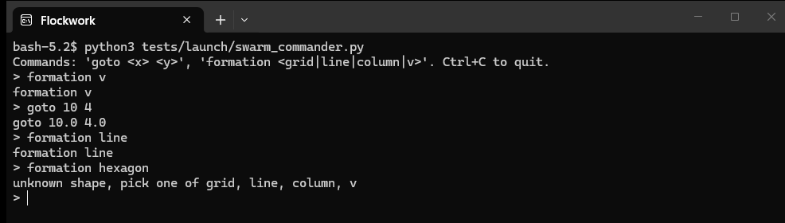
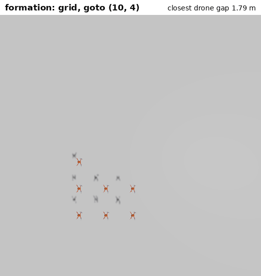
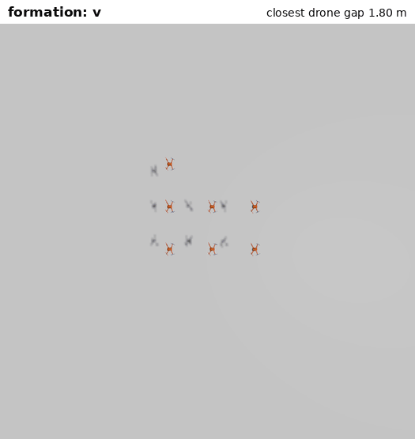
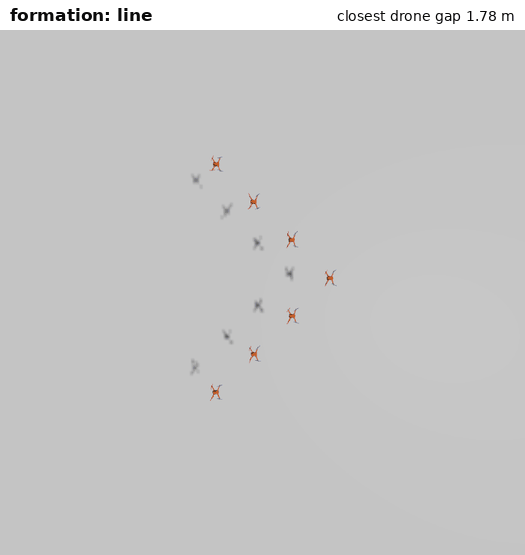
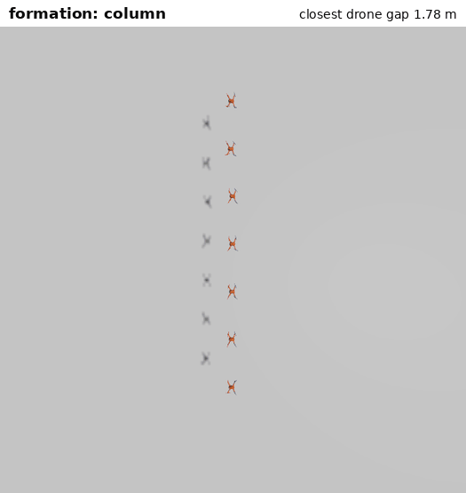
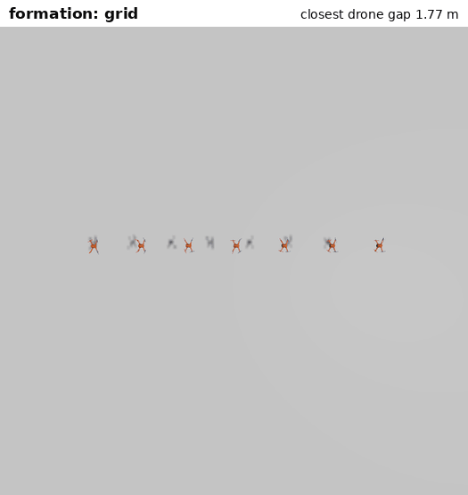

# Commands

This file documents on how to move the drones into formation.

## Quick start

Terminal 1, launch the swarm from the repo root:

```bash
source /opt/ros/jazzy/setup.bash
colcon build --packages-select swarm_control
source install/setup.bash
ros2 launch tests/launch/stress_test.launch.py num_drones:=7
```

Terminal 2, once all drones are hovering at the destination:

```bash
source /opt/ros/jazzy/setup.bash
python3 tests/launch/swarm_commander.py
```



## Commands

Every shape keeps `desired_spacing` (1.8 m ) between neighbors and is centered on the target, drawn in world axes.

The GIFs below are a top-down view of one 7-drone runs, pretty cool.

### `goto <x> <y>`

Moves the formation center to (x, y), holding the current shape on the way.



### `formation v`

Wedge with the tip pointing toward +x.



### `formation line`

One row along the y axis.



### `formation column`

One file along the x axis.



### `formation grid`

Rows of up to ceil(sqrt(N)) drones, the default shape.



## How a switch works

1. Every drone receives the new shape name on /swarm/formation.
2. Each drone builds the slot list for that shape and solves the same assignment, which drone takes which slot, minimizing the total squared distance from the old slots (Hungarian algorithm). Same inputs give pretty much the same answer, this is "os" that all drones agree without exchanging anything.
3. Each slot slides from its old spot to its new one over formation_transition_time (3 s). Straight synchronized moves under this assignment keep paths from crossing (CAPT, Turpin et al. 2014).
4. The usual layers keep running on top: neighbor braking, obstacle avoidance, settle mode.

## Scripted missions

Pass timed steps to the launch file, times are seconds since launch:

```bash
ros2 launch tests/launch/stress_test.launch.py num_drones:=7 \
  mission:='35 goto 10 4; 55 formation v; 75 formation line; 95 formation column; 115 formation grid'
```

This is the mission used for the GIFs above.

## Raw topics

The commander is a wrapper, any node can publish these:

| Topic | Type | Example |
| --- | --- | --- |
| `/swarm/target` | `geometry_msgs/Point` | `ros2 topic pub --once /swarm/target geometry_msgs/msg/Point "{x: 6.0, y: 5.0}"` |
| `/swarm/formation` | `std_msgs/String` | `ros2 topic pub --once /swarm/formation std_msgs/msg/String "{data: v}"` |

Per-drone targets still work through `/<drone>/manual_target` (see `tests/launch/manual_target.py`).

## Launch arguments

| Argument | Default | Meaning |
| --- | --- | --- |
| `num_drones` | `6` | Swarm size. |
| `use_formation` | `true` | Hold formation slots around the target. |
| `formation` | `grid` | Starting shape. |
| `formation_transition_time` | `3.0` | Seconds for slots to slide to a new shape. |
| `formation_gain` | `0.8` | Pull toward the slot. |
| `formation_deadband` | `0.15` | Slot error in meters that is left alone. |
| `mission` | empty | Timed commands, see above. |

## Extra info

- If drones act strangely, check for a leftover simulation first (`ps aux | grep gz`).
